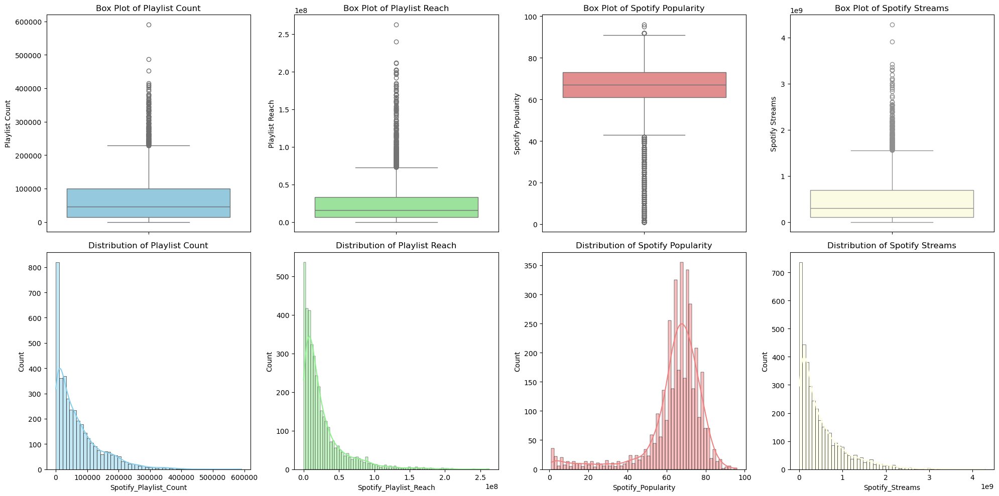
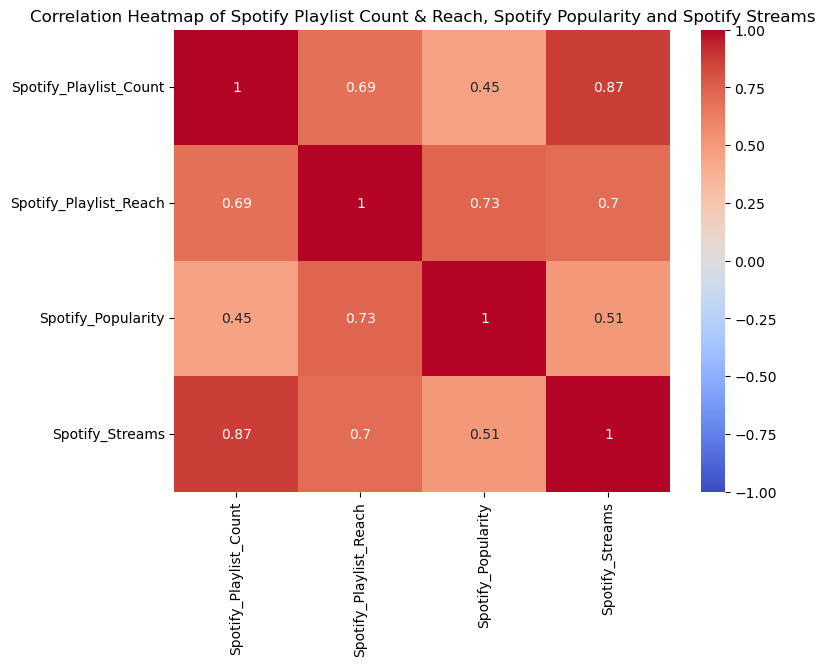
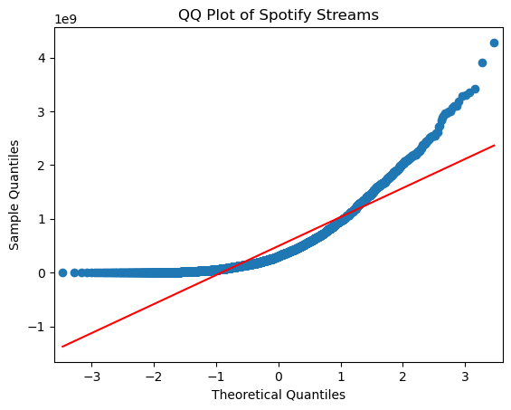
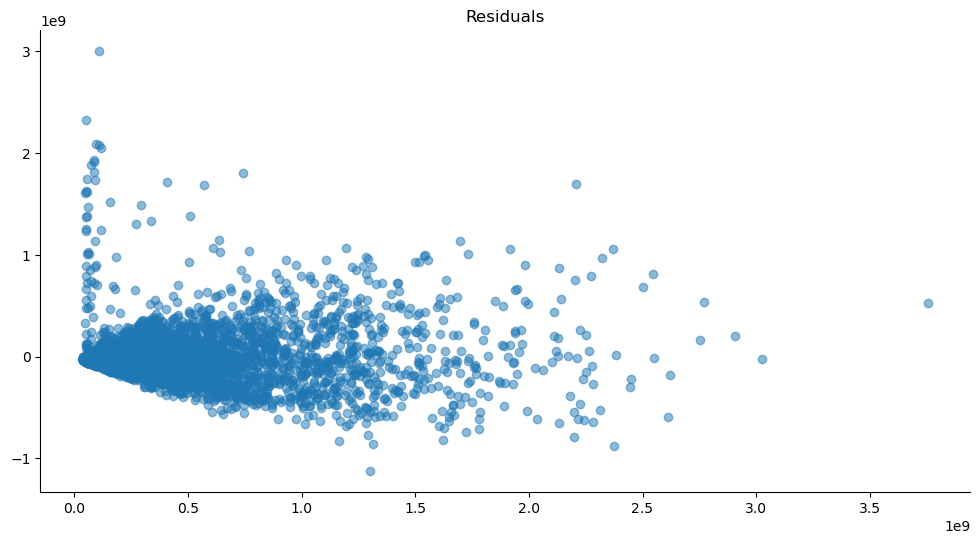
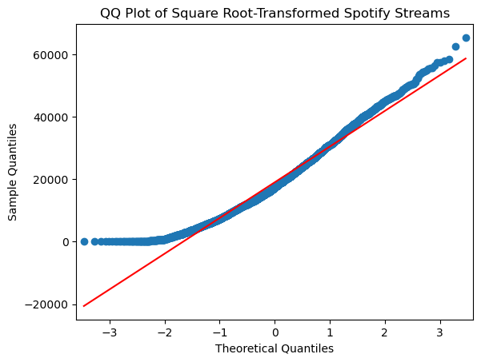

# Most Streamed Songs on Spotify (2024)

**Exploring the best predictors of song performance and testing for group differences**

A two-method statistical analysis of 4,600 tracks, testing whether playlist placement and
popularity metrics explain how many streams a song receives on Spotify.

*Group project — Research Methods for Business Analytics.*

---

## Research questions

1. Do **Spotify Playlist Count**, **Spotify Playlist Reach** and **Spotify Popularity**
   significantly influence the total number of **Spotify Streams**?
2. Is there a significant difference in streams between songs with **high** and **low**
   values of these metrics?

**Data:** *Most Streamed Spotify Songs 2024* — 4,600 tracks, 29 variables.
**Stack:** `pandas` · `statsmodels` · `scipy` · `seaborn` · `matplotlib`

---

## Step 1 — Data cleaning

Starting point: 4,600 rows, but most numeric fields imported as `object` (thousands
separators stored as text) and nulls unevenly distributed across columns.

| Action | Detail |
|---|---|
| Dropped near-empty columns | `TIDAL_Popularity` (100% null), `Soundcloud_Streams`, `SiriusXM_Spins`, `Pandora_Track_Stations` |
| Dropped rows with nulls | Only on the four variables of interest |
| Type conversion | Stripped commas, cast the four key variables to numeric; parsed `Release_Date` as datetime |
| Removed duplicates | — |

**Result: 3,778 usable observations.**

---

## Step 2 — Exploratory data analysis

### 2.1 Summary statistics

| Variable | Mean | S.D. | Max |
|---|---|---|---|
| Spotify Playlist Count | 69,835 | 73,402 | 590,392 |
| Spotify Playlist Reach | 26.2M | 31.1M | 262.3M |
| Spotify Popularity | 63.71 | 15.87 | 96 |
| Spotify Streams | 493.5M | 539.9M | 4.28B |

Standard deviations are as large as (or larger than) the means for the playlist variables
and for streams — an early signal of extreme dispersion. Popularity, bounded on a 0–100
scale, is the only well-behaved variable.

### 2.2 Distributions and outliers



All three volume-based variables are strongly right-skewed with long upper tails:

- **14.69%** of tracks exceed 1 billion streams
- **6.75%** appear in more than 200,000 playlists
- **3.55%** have a playlist reach above 100 million

The streaming landscape is dominated by a small number of extreme hits. Popularity is the
exception — roughly symmetrical, concentrated in the 60–80 range.

### 2.3 Correlations

Spearman was chosen over Pearson because the variables are non-normal and outlier-heavy.



| Pair | ρ |
|---|---|
| Playlist Count ↔ Streams | **0.87** |
| Playlist Reach ↔ Streams | **0.70** |
| Popularity ↔ Streams | **0.51** |
| Playlist Reach ↔ Popularity | 0.73 |
| Playlist Count ↔ Playlist Reach | 0.69 |

Playlist count is by far the strongest predictor. The independent variables are also
correlated with each other, which motivates the multicollinearity check in Step 4.

### 2.4 Normality of the dependent variable



Streams follow a normal distribution only in the central region. Beyond roughly ±1
theoretical quantile the tails are much heavier than normal — the same outliers seen in
the box plots.

---

## Step 3 — Method 1: Multiple linear regression (OLS)

> **H₀:** β₁ = β₂ = β₃ = 0 — the three metrics have no effect on streams
> **H₁:** at least one βᵢ ≠ 0

| | Coefficient | t | p |
|---|---|---|---|
| Constant | 5.97e+07 | 3.03 | 0.003 |
| Playlist Count | **5,450.60** | 69.64 | <0.001 |
| Playlist Reach | **3.12** | 16.05 | <0.001 |
| Popularity | −4.48e+05 | −1.35 | 0.178 |

**R² = 0.729 · F = 3,385 · p < 0.001 · n = 3,778**

The model explains 72.9% of the variance in streams. Playlist count and reach are highly
significant; **popularity is not**, and its coefficient is negative — counter-intuitive,
and a first hint that the model is misspecified.

---

## Step 4 — Testing the Gauss-Markov assumptions

| Assumption | Test | Result |
|---|---|---|
| Linearity | Actual vs. predicted plot | ❌ Violated — funnel shape |
| No multicollinearity | VIF (3.58 / 2.97 / 2.88) | ✅ All below 5 |
| Normality of residuals | Q-Q plot | ❌ Heavy tails |
| Homoscedasticity | Residuals vs. fitted | ❌ Violated |
| Independence of errors | Durbin-Watson = 1.96 | ✅ Within 1.5–2.5 |



Residual variance grows systematically with fitted values, and residuals for
high-streaming songs are predominantly **positive** — the model consistently
underestimates the biggest hits. Under heteroscedasticity the standard errors are
unreliable, so the p-values above cannot be taken at face value.

---

## Step 5 — Square-root transformation

The dependent variable was transformed as √(Spotify Streams). A square root compresses
large values more aggressively than small ones, which targets exactly the upper tail
driving the problem.



| | Coefficient | t | p |
|---|---|---|---|
| Constant | 4,421.65 | 10.46 | <0.001 |
| Playlist Count | **0.1146** | 68.38 | <0.001 |
| Playlist Reach | **3.27e−05** | 7.87 | <0.001 |
| Popularity | **90.46** | 12.73 | <0.001 |

**R² = 0.724 · F = 3,292 · p < 0.001**

Two things change. **All three coefficients are now significant and positive**, including
popularity — which is theoretically coherent, since more popular songs should not get
*fewer* streams. And residual **kurtosis drops from 17.16 to 9.45**, confirming a
substantially better-behaved error distribution. Explanatory power is essentially
unchanged.

---

## Step 6 — Method 2: Mann-Whitney U test

To answer the second research question without relying on normality, each independent
variable was split at its **25th percentile** (bottom 25% vs. top 75%) and the two groups
compared on streams. Mann-Whitney compares medians rather than means, making it robust to
the outliers identified in Step 2.

| Split variable | Median streams (high) | Median streams (low) | U | p |
|---|---|---|---|---|
| Playlist Count | 444.6M | 39.1M | 2,493,232 | <0.001 |
| Playlist Reach | 443.9M | 66.7M | 2,331,618 | <0.001 |
| Popularity | 436.0M | 92.9M | 2,259,974 | <0.001 |

H₀ is rejected in all three cases. The gap is widest for playlist count, where the
high group's median is over **11× larger** than the low group's — consistent with the
regression, where playlist count was also the dominant predictor.

---

## Conclusions

- Playlist metrics are strong predictors of streaming performance; **playlist count is
  the single most important variable** across both methods.
- The raw OLS model violates linearity and homoscedasticity. The square-root
  transformation fixes enough of this to make all three predictors significant and
  correctly signed.
- Even after transformation, the model **underestimates songs with exceptionally high
  streams**, so predictions at the top of the distribution should be treated with caution.
- The non-parametric test confirms the regression findings independently: the effect of
  these metrics is not uniform, and songs with high metric values perform dramatically
  better than those with low ones.

---

## Repository contents

```
Spotify_2024.ipynb                       Full analysis notebook
Most_Streamed_Spotify_Songs_2024.csv     Source dataset
images/                                  Figures used in this README
```

## Reproducing

```bash
pip install pandas numpy statsmodels scipy seaborn matplotlib
jupyter notebook Spotify_2024.ipynb
```
